# Database Document Object Model (DOM) & Schema

This document outlines the database schema, table structures, and relationships for the **EventStream** project.

## ER Diagram

```mermaid
erDiagram
    users {
        SERIAL id
        VARCHAR(100) name
        VARCHAR(255) email
        VARCHAR(255) password_hash
        VARCHAR(50) role
        TIMESTAMP created_at
    }
    buildings {
        SERIAL id
        VARCHAR(100) name
        TEXT address
        TIMESTAMP created_at
    }
    devices {
        SERIAL id
        VARCHAR(100) name
        VARCHAR(50) type
        INT building_id
        VARCHAR(20) floor
        VARCHAR(50) room
        VARCHAR(20) status
        TIMESTAMP created_at
    }
    alert_rules {
        SERIAL id
        VARCHAR(100) name
        VARCHAR(50) device_type
        VARCHAR(50) metric
        VARCHAR(10) operator
        NUMERIC threshold
        BOOLEAN bool_value
        VARCHAR(20) severity
        BOOLEAN is_active
        TIMESTAMP created_at
    }
    alerts {
        SERIAL id
        INT device_id
        INT alert_rule_id
        VARCHAR(100) type
        VARCHAR(20) severity
        VARCHAR(20) status
        TEXT message
        TIMESTAMP triggered_at
        TIMESTAMP acknowledged_at
        TIMESTAMP resolved_at
    }
    alert_activity_logs {
        SERIAL id
        INT alert_id
        INT user_id
        VARCHAR(50) action
        TEXT note
        TIMESTAMP created_at
    }
    floors {
        SERIAL id
        INT building_id
        INT level
        VARCHAR(100) name
        TIMESTAMP created_at
    }
    rooms {
        SERIAL id
        INT floor_id
        VARCHAR(100) name
        VARCHAR(50) type
        TIMESTAMP created_at
    }
    device_models {
        SERIAL id
        VARCHAR(100) brand
        VARCHAR(100) model_name
        VARCHAR(50) sensor_type
        INT heartbeat_interval
        TIMESTAMP created_at
    }
    sensor_requests {
        SERIAL id
        INT user_id
        INT building_id
        INT floor_id
        INT room_id
        VARCHAR(50) sensor_type
        TEXT reason
        VARCHAR(20) status
        INT fulfilled_by
        TIMESTAMP fulfilled_at
        TIMESTAMP created_at
    }
    telemetry {
        SERIAL id
        INT device_id
        DECIMAL(52) temperature
        DECIMAL(52) humidity
        VARCHAR(50) status
        TIMESTAMP timestamp
    }
    audit_logs {
        SERIAL id
        INT user_id
        VARCHAR(100) action
        VARCHAR(50) entity_type
        INT entity_id
        JSONB details
        VARCHAR(50) ip_address
        TIMESTAMP created_at
    }
    sessions {
        UUID id
        INT user_id
        VARCHAR(255) device_info
        VARCHAR(45) ip_address
        BOOLEAN is_active
        TIMESTAMP last_active_at
        TIMESTAMP created_at
    }
    failed_events {
        SERIAL id
        JSONB payload
        TEXT error_reason
        VARCHAR(45) source_ip
        TIMESTAMP created_at
    }
    organizations {
        SERIAL id
        VARCHAR(255) name
        VARCHAR(255) domain
        VARCHAR(50) status
        TIMESTAMP created_at
        TIMESTAMP updated_at
    }
    api_keys {
        SERIAL id
        INTEGER organization_id
        VARCHAR(255) name
        VARCHAR(255) key_hash
        VARCHAR(20) preview
        VARCHAR[] scopes
        BOOLEAN is_active
        TIMESTAMP expires_at
        TIMESTAMP last_used_at
        TIMESTAMP created_at
        INTEGER created_by
    }
    device_groups {
        SERIAL id
        INTEGER organization_id
        VARCHAR(255) name
        TEXT description
        TIMESTAMP created_at
        TIMESTAMP updated_at
    }
    device_twins {
        INT device_id
        JSONB desired_state
        JSONB reported_state
        JSONB configuration
        INT health_score
        TIMESTAMP updated_at
    }
    notification_channels {
        SERIAL id
        INT organization_id
        VARCHAR(100) name
        VARCHAR(50) type
        TEXT webhook_url
        BOOLEAN is_active
        TIMESTAMP created_at
        TIMESTAMP updated_at
    }
    device_group_members {
        INTEGER group_id
        INTEGER device_id
    }
    ai_configurations {
        SERIAL id
        INTEGER organization_id
        VARCHAR(50) provider_type
        VARCHAR(500) api_key
        VARCHAR(100) model_name
        BOOLEAN is_active
        TIMESTAMP created_at
        TIMESTAMP updated_at
    }
    feature_flags {
        SERIAL id
        INTEGER organization_id
        VARCHAR(100) feature_key
        BOOLEAN is_enabled
        TIMESTAMP created_at
        TIMESTAMP updated_at
    }
    api_logs {
        SERIAL id
        INTEGER organization_id
        INTEGER api_key_id
        VARCHAR(255) endpoint
        VARCHAR(10) method
        INTEGER status_code
        INTEGER duration_ms
        VARCHAR(45) ip_address
        TEXT user_agent
        TIMESTAMP created_at
    }
    report_schedules {
        SERIAL id
        INT organization_id
        VARCHAR(100) report_type
        VARCHAR(20) format
        VARCHAR(20) frequency
        JSONB recipients
        TIMESTAMP last_run_at
        TIMESTAMP created_at
        INT created_by
    }
    escalation_policies {
        SERIAL id
        INT organization_id
        VARCHAR(255) name
        INT wait_minutes
        INT notification_channel_id
        TIMESTAMP created_at
        TIMESTAMP updated_at
    }
    organizations ||--o{ users : "has many"
    organizations ||--o{ buildings : "has many"
    organizations ||--o{ devices : "has many"
    buildings ||--o{ devices : "has many"
    device_models ||--o{ devices : "has many"
    devices ||--o{ alerts : "has many"
    organizations ||--o{ alert_rules : "has many"
    devices ||--o{ telemetry : "has many"
    organizations ||--o{ sensor_requests : "has many"
    users ||--o{ sessions : "has many"
    users ||--o{ audit_logs : "has many"
    organizations ||--o{ notification_channels : "has many"
    organizations ||--o{ report_schedules : "has many"
```

## Tables

### users
| Column | Type |
|---|---|
| `id` | `SERIAL` |
| `name` | `VARCHAR(100)` |
| `email` | `VARCHAR(255)` |
| `password_hash` | `VARCHAR(255)` |
| `role` | `VARCHAR(50)` |
| `created_at` | `TIMESTAMP` |

### buildings
| Column | Type |
|---|---|
| `id` | `SERIAL` |
| `name` | `VARCHAR(100)` |
| `address` | `TEXT` |
| `created_at` | `TIMESTAMP` |

### devices
| Column | Type |
|---|---|
| `id` | `SERIAL` |
| `name` | `VARCHAR(100)` |
| `type` | `VARCHAR(50)` |
| `building_id` | `INT` |
| `floor` | `VARCHAR(20)` |
| `room` | `VARCHAR(50)` |
| `status` | `VARCHAR(20)` |
| `created_at` | `TIMESTAMP` |

### alert_rules
| Column | Type |
|---|---|
| `id` | `SERIAL` |
| `name` | `VARCHAR(100)` |
| `device_type` | `VARCHAR(50)` |
| `metric` | `VARCHAR(50)` |
| `operator` | `VARCHAR(10)` |
| `threshold` | `NUMERIC` |
| `bool_value` | `BOOLEAN` |
| `severity` | `VARCHAR(20)` |
| `is_active` | `BOOLEAN` |
| `created_at` | `TIMESTAMP` |

### alerts
| Column | Type |
|---|---|
| `id` | `SERIAL` |
| `device_id` | `INT` |
| `alert_rule_id` | `INT` |
| `type` | `VARCHAR(100)` |
| `severity` | `VARCHAR(20)` |
| `status` | `VARCHAR(20)` |
| `message` | `TEXT` |
| `triggered_at` | `TIMESTAMP` |
| `acknowledged_at` | `TIMESTAMP` |
| `resolved_at` | `TIMESTAMP` |

### alert_activity_logs
| Column | Type |
|---|---|
| `id` | `SERIAL` |
| `alert_id` | `INT` |
| `user_id` | `INT` |
| `action` | `VARCHAR(50)` |
| `note` | `TEXT` |
| `created_at` | `TIMESTAMP` |

### floors
| Column | Type |
|---|---|
| `id` | `SERIAL` |
| `building_id` | `INT` |
| `level` | `INT` |
| `name` | `VARCHAR(100)` |
| `created_at` | `TIMESTAMP` |

### rooms
| Column | Type |
|---|---|
| `id` | `SERIAL` |
| `floor_id` | `INT` |
| `name` | `VARCHAR(100)` |
| `type` | `VARCHAR(50)` |
| `created_at` | `TIMESTAMP` |

### device_models
| Column | Type |
|---|---|
| `id` | `SERIAL` |
| `brand` | `VARCHAR(100)` |
| `model_name` | `VARCHAR(100)` |
| `sensor_type` | `VARCHAR(50)` |
| `heartbeat_interval` | `INT` |
| `created_at` | `TIMESTAMP` |

### sensor_requests
| Column | Type |
|---|---|
| `id` | `SERIAL` |
| `user_id` | `INT` |
| `building_id` | `INT` |
| `floor_id` | `INT` |
| `room_id` | `INT` |
| `sensor_type` | `VARCHAR(50)` |
| `reason` | `TEXT` |
| `status` | `VARCHAR(20)` |
| `fulfilled_by` | `INT` |
| `fulfilled_at` | `TIMESTAMP` |
| `created_at` | `TIMESTAMP` |

### telemetry
| Column | Type |
|---|---|
| `id` | `SERIAL` |
| `device_id` | `INT` |
| `temperature` | `DECIMAL(52)` |
| `humidity` | `DECIMAL(52)` |
| `status` | `VARCHAR(50)` |
| `timestamp` | `TIMESTAMP` |

### audit_logs
| Column | Type |
|---|---|
| `id` | `SERIAL` |
| `user_id` | `INT` |
| `action` | `VARCHAR(100)` |
| `entity_type` | `VARCHAR(50)` |
| `entity_id` | `INT` |
| `details` | `JSONB` |
| `ip_address` | `VARCHAR(50)` |
| `created_at` | `TIMESTAMP` |

### sessions
| Column | Type |
|---|---|
| `id` | `UUID` |
| `user_id` | `INT` |
| `device_info` | `VARCHAR(255)` |
| `ip_address` | `VARCHAR(45)` |
| `is_active` | `BOOLEAN` |
| `last_active_at` | `TIMESTAMP` |
| `created_at` | `TIMESTAMP` |

### failed_events
| Column | Type |
|---|---|
| `id` | `SERIAL` |
| `payload` | `JSONB` |
| `error_reason` | `TEXT` |
| `source_ip` | `VARCHAR(45)` |
| `created_at` | `TIMESTAMP` |

### organizations
| Column | Type |
|---|---|
| `id` | `SERIAL` |
| `name` | `VARCHAR(255)` |
| `domain` | `VARCHAR(255)` |
| `status` | `VARCHAR(50)` |
| `created_at` | `TIMESTAMP` |
| `updated_at` | `TIMESTAMP` |

### api_keys
| Column | Type |
|---|---|
| `id` | `SERIAL` |
| `organization_id` | `INTEGER` |
| `name` | `VARCHAR(255)` |
| `key_hash` | `VARCHAR(255)` |
| `preview` | `VARCHAR(20)` |
| `scopes` | `VARCHAR[]` |
| `is_active` | `BOOLEAN` |
| `expires_at` | `TIMESTAMP` |
| `last_used_at` | `TIMESTAMP` |
| `created_at` | `TIMESTAMP` |
| `created_by` | `INTEGER` |

### device_groups
| Column | Type |
|---|---|
| `id` | `SERIAL` |
| `organization_id` | `INTEGER` |
| `name` | `VARCHAR(255)` |
| `description` | `TEXT` |
| `created_at` | `TIMESTAMP` |
| `updated_at` | `TIMESTAMP` |

### device_twins
| Column | Type |
|---|---|
| `device_id` | `INT` |
| `desired_state` | `JSONB` |
| `reported_state` | `JSONB` |
| `configuration` | `JSONB` |
| `health_score` | `INT` |
| `updated_at` | `TIMESTAMP` |

### notification_channels
| Column | Type |
|---|---|
| `id` | `SERIAL` |
| `organization_id` | `INT` |
| `name` | `VARCHAR(100)` |
| `type` | `VARCHAR(50)` |
| `webhook_url` | `TEXT` |
| `is_active` | `BOOLEAN` |
| `created_at` | `TIMESTAMP` |
| `updated_at` | `TIMESTAMP` |

### device_group_members
| Column | Type |
|---|---|
| `group_id` | `INTEGER` |
| `device_id` | `INTEGER` |

### ai_configurations
| Column | Type |
|---|---|
| `id` | `SERIAL` |
| `organization_id` | `INTEGER` |
| `provider_type` | `VARCHAR(50)` |
| `api_key` | `VARCHAR(500)` |
| `model_name` | `VARCHAR(100)` |
| `is_active` | `BOOLEAN` |
| `created_at` | `TIMESTAMP` |
| `updated_at` | `TIMESTAMP` |

### feature_flags
| Column | Type |
|---|---|
| `id` | `SERIAL` |
| `organization_id` | `INTEGER` |
| `feature_key` | `VARCHAR(100)` |
| `is_enabled` | `BOOLEAN` |
| `created_at` | `TIMESTAMP` |
| `updated_at` | `TIMESTAMP` |

### api_logs
| Column | Type |
|---|---|
| `id` | `SERIAL` |
| `organization_id` | `INTEGER` |
| `api_key_id` | `INTEGER` |
| `endpoint` | `VARCHAR(255)` |
| `method` | `VARCHAR(10)` |
| `status_code` | `INTEGER` |
| `duration_ms` | `INTEGER` |
| `ip_address` | `VARCHAR(45)` |
| `user_agent` | `TEXT` |
| `created_at` | `TIMESTAMP` |

### report_schedules
| Column | Type |
|---|---|
| `id` | `SERIAL` |
| `organization_id` | `INT` |
| `report_type` | `VARCHAR(100)` |
| `format` | `VARCHAR(20)` |
| `frequency` | `VARCHAR(20)` |
| `recipients` | `JSONB` |
| `last_run_at` | `TIMESTAMP` |
| `created_at` | `TIMESTAMP` |
| `created_by` | `INT` |

### escalation_policies
| Column | Type |
|---|---|
| `id` | `SERIAL` |
| `organization_id` | `INT` |
| `name` | `VARCHAR(255)` |
| `wait_minutes` | `INT` |
| `notification_channel_id` | `INT` |
| `created_at` | `TIMESTAMP` |
| `updated_at` | `TIMESTAMP` |

